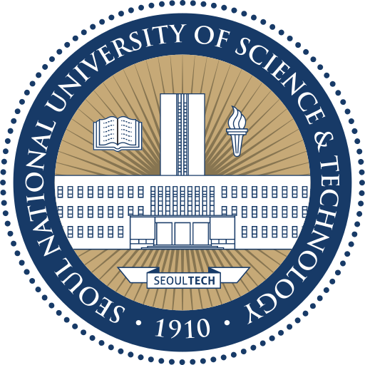

<p align="center">
  
</p>

<h1 align="center">서울과기대 LMS e-Class 커넥터 · macOS</h1>

<p align="center">
  <strong>수업 공지와 과제를 일일이 찾지 말고, AI에게 물어보세요.</strong><br>
  서울과학기술대학교 e-Class의 공지·과제·마감일을 Codex와 Claude가 읽을 수 있게 연결하는<br>
  macOS용 읽기 전용 로컬 MCP 커넥터입니다.
</p>

<p align="center">
  
  
  
  
</p>

> [!IMPORTANT]
> 서울과학기술대학교 또는 e-Class 운영사가 제작·승인·지원하는 공식 프로그램이 아닌 독립적인 커뮤니티 프로젝트입니다. 시험, 과제, 출석, 제출 여부와 마감 시각은 반드시 e-Class 원문에서 최종 확인하세요. 자세한 내용은 [DISCLAIMER.md](DISCLAIMER.md)를 확인하세요.

## AST LMS 강화본

Agent for SeoulTech 저장소에서 관리하는 Codex·Claude용 독립 MCP예요. 이 폴더의 가상환경에 `pip install -e .`로 설치하고 `python -m seoultech_lms.mcp_server`로 실행해요. 설치 스크립트는 배포본과 같은 사용자 범위 설치 경로를 사용해요. 현재 TLS 이슈와 후속 조치는 [TODO.md](TODO.md)에 기록했어요.

| MCP 도구 | 조회 범위 |
|---|---|
| `get_student_profile` | e-Class 내 정보에 표시된 본인 이름, 소속 학과, 학년. `include_contact=true`이면 전화번호와 이메일도 반환 |
| `get_assignment_summary` | 정규·비정규 수강 강좌에서 홈 할일과 최신 과제 목록을 대조한 미제출·제출 미확인 과제, 마감·지각 마감, 조회 실패 범위 |
| `list_assignments` | 과제의 교수자 안내 전문, 마감일, 제출 여부 |
| `list_posts`, `get_post` | 과제, 과목 공지, 학교 전체 공지, 강의자료, 열린게시판, 질의응답, 토론 주제의 목록과 본문. 상세는 확인 가능한 첨부 목록도 반환 |
| `list_course_files` | 강좌 파일모음의 파일명과 ID |
| `read_attachment` | 게시물·파일모음에서 확인한 PDF의 페이지별 텍스트 |
| `get_syllabus` | 강의계획서 본문과 표 |

- `list_posts`의 `kind`는 `assignment`, `course_notice`, `system_notice`, `material`, `open_board`, `qna`, `discussion` 중 하나예요. 학교 전체 공지를 제외하면 수강 중인 강좌의 `course_id`를 사용해요.
- `get_assignment_summary`, `get_pending_assignments`, `get_upcoming_deadlines`는 요청마다 수강 목록과 강좌별 과제 목록을 조회해요. 새 과제나 목록 표시가 바뀐 과제, 확인이 끝나지 않은 과제의 상세를 읽어요. 이전에 확인한 마감·제출 상태는 같은 로그인 세션에서 최대 10분 재사용해요. `get_assignment_summary(refresh_details=true)`로 현재 과제의 마감 상세도 다시 확인할 수 있어요. 홈 할일은 강좌 목록에 빠진 과제를 찾는 데 사용해요.
- `get_assignment_summary`의 `unavailable`은 확인하지 못한 강좌나 상세 범위를 알려줘요. 단순 목록을 반환하는 `get_pending_assignments`와 `get_upcoming_deadlines`는 정규 강좌를 조회하고 일부 범위를 확인하지 못하면 오류를 반환해요. 교수자 안내 본문이 필요하면 `list_assignments` 또는 특정 과제의 `get_post`를 사용해요.
- `get_post`에 목록에서 찾은 `post_id`와 같은 `kind`, `course_id`, `page`, 필요한 경우 `board_id`를 넘겨요. `attachments`가 `null`이면 첨부 목록을 확인할 수 없는 화면이고, `[]`이면 조회한 목록이 비어 있어요.
- `read_attachment`에 같은 게시물 정보와 `attachment_id`를 넘겨요. 파일모음은 `kind="file_collection"`과 `course_id`, `attachment_id`를 사용해요. 응답의 `next_page` 값으로 이어 읽을 수 있어요. 최대 12 MiB의 PDF에서 텍스트를 읽어요. 이미지로만 구성된 페이지는 빈 문자열로 반환되며 OCR은 별도 작업이에요.
- 열린게시판은 빈 목록만 실서버에서 확인했고, 토론은 주제 본문까지 확인했어요. 질의응답 첨부와 개별 토론 답글은 실제 표본 검증이 남아 있어요. 강의계획서 표본에는 첨부가 없었어요.

## 할 수 있는 일

```text
“이번 스페인어 테스트 날짜·시간·장소 찾아줘.”
“모든 과목 공지를 확인해서 중간고사 일정만 표로 만들어줘.”
“현재 미제출 과제를 마감이 가까운 순서로 정리해줘.”
“7일 안에 마감되는 과제를 과목별로 정리해줘.”
```

| 지원 기능 | 내용 |
| --- | --- |
| 수강 과목 | 현재 정규 수강 과목 조회 |
| 공지 | 과목별·전체 공지, 게시일과 전체 본문 조회 |
| 공지 검색 | 공지 본문에서 시험·준비물·일정 변경 등 검색 |
| 과제 | 과목별·전체 과제, 교수자 안내 본문, 마감일과 제출 여부 조회 |
| 미제출·마감 | 미제출 과제와 일정 기간 안에 마감되는 과제 조회 |
| AI 연동 | Codex 플러그인, Claude Desktop, Claude Code용 로컬 MCP |

과제 제출, 파일 업로드, 게시물 작성·수정·삭제 기능은 제공하지 않습니다.

## 처음 설치하는 사람용 가이드

### 1. Python 3.12 설치

Mac에 Python 3.12가 없다면 [Python 공식 macOS 다운로드 페이지](https://www.python.org/downloads/macos/)에서 Python 3.12용 macOS 설치 파일을 받아 설치합니다.

Homebrew를 이미 사용 중이라면 Terminal에서 다음 명령을 써도 됩니다.

```bash
brew install python@3.12
```

### 2. 배포 ZIP 압축 풀기

`seoultech-lms-connector-macos-v0.3.4.zip`을 더블클릭해 압축을 풉니다. `Source code` ZIP이 아니라 이름에 `macos`가 들어간 설치용 ZIP을 사용하세요.

### 3. Terminal에서 설치

1. `응용 프로그램 > 유틸리티 > 터미널`을 엽니다.
2. 터미널에 `cd `를 입력하되 Enter는 아직 누르지 않습니다.
3. 압축을 푼 `seoultech-lms-connector-macos-v0.3.4` 폴더를 터미널 창으로 끌어다 놓습니다.
4. Enter를 누릅니다.
5. 아래 명령을 입력합니다.

```bash
bash install.sh
```

설치 스크립트는 다음 작업을 자동으로 처리합니다.

- `~/Library/Application Support/seoultech-lms-connector/venv`에 전용 Python 환경 생성
- 필요한 Python 패키지 설치
- 로그인과 세션 점검에 필요한 Playwright Chromium 설치
- Codex 개인 마켓플레이스 등록과 플러그인 설치
- Claude Desktop 기본 로컬 MCP 구성
- Claude Code가 설치돼 있으면 사용자 범위 MCP 등록
- 최초 e-Class 로그인 진행

설치 중 브라우저가 열리면 사용자가 직접 서울과기대 e-Class에 로그인합니다. 아이디와 비밀번호를 설치 스크립트나 AI에 입력하면 안 됩니다.

> [!TIP]
> ZIP의 실행 권한이 유지된 환경에서는 `install.command`를 더블클릭해도 됩니다. macOS가 파일 실행을 막거나 창이 바로 닫히면 위의 `bash install.sh` 방식이 가장 확실합니다.

### 4. Claude Desktop 확장 선택 설치

기본 Claude MCP 연결은 설치 스크립트가 이미 구성합니다. 로고와 설명이 표시되는 확장도 쓰고 싶다면 설치 마지막에 안내되는 파일을 Claude Desktop에서 직접 선택합니다.

1. Claude Desktop에서 `Settings > Extensions`로 이동합니다.
2. `Advanced settings > Install Extension`을 선택합니다.
3. 다음 파일을 선택하고 설치를 승인합니다.

```text
~/Library/Application Support/seoultech-lms-connector/seoultech-c4t.mcpb
```

확장 설치가 실패하더라도 기존 기본 MCP 연결은 삭제되지 않습니다.

### 5. 앱 재시작 및 확인

Codex와 Claude를 창만 닫지 말고 완전히 종료한 뒤 다시 실행합니다.

- 설치 결과가 `일부 설치만 완료`라면 Codex의 플러그인 목록에서 `Personal > seoultech_c4t`를 찾아 `+` 버튼으로 설치합니다. 스크립트가 `설치 완료`라고 표시했다면 이 수동 단계는 필요하지 않습니다.
- Claude Desktop에서는 채팅 입력창의 연결/도구 목록에서 `seoultech_c4t`를 확인합니다.

요청 예시:

```text
@seoultech_c4t 현재 제출해야 하는 과제 정리해줘.
@seoultech_c4t 7일 안에 마감되는 미제출 과제 알려줘.
@seoultech_c4t 과목별 최근 공지를 요약해줘.
```

Claude Desktop 또는 Claude Code에서는 이름을 붙이지 않고 자연어로 요청해도 됩니다.

## 지원 환경

| 환경 | 지원 여부 | 비고 |
| --- | :---: | --- |
| macOS Apple Silicon | ✅ | `python3.12` 또는 `/opt/homebrew/bin/python3.12` 자동 탐색 |
| macOS Intel | ✅ | `python3.12` 또는 `/usr/local/bin/python3.12` 자동 탐색 |
| Codex | ✅ | 로컬 개인 플러그인으로 구성 |
| Claude Desktop | ✅ | 기본 로컬 MCP 및 선택적 `.mcpb` 확장 |
| Claude Code | ✅ | CLI가 있으면 사용자 범위 MCP로 등록 |
| 일반 웹·모바일 Chat | ❌ | 이 Mac의 로컬 프로세스에 접근할 수 없음 |
| Windows | ❌ | Windows 전용 배포본을 사용해야 함 |

## 개인정보와 저장 위치

- 로그인 세션: `~/Library/Application Support/seoultech-lms-connector/auth_state.json`
- 전용 Python 환경: `~/Library/Application Support/seoultech-lms-connector/venv`
- Claude 확장 파일: `~/Library/Application Support/seoultech-lms-connector/seoultech-c4t.mcpb`
- Claude Desktop 설정: `~/Library/Application Support/Claude/claude_desktop_config.json`
- Codex 플러그인: `~/.codex/plugins/seoultech-c4t`
- Codex 개인 마켓플레이스: `~/.agents/plugins/marketplace.json`

`auth_state.json`에는 로그인 세션 정보가 들어 있으므로 다른 사람에게 보내거나 GitHub에 올리면 안 됩니다.
설치 프로그램은 이 폴더를 사용자만 접근 가능한 권한으로 만들고, 세션 파일을 macOS에서 `600` 권한으로 저장합니다.

## 로그인 세션 갱신

AI가 세션 만료를 알리면 `start_login` 도구로 로그인 창을 열 수 있습니다. 터미널에서 직접 갱신하려면 다음 명령을 사용합니다.

```bash
"$HOME/Library/Application Support/seoultech-lms-connector/venv/bin/seoultech-lms" login
```

설치 상태를 확인하려면:

```bash
"$HOME/Library/Application Support/seoultech-lms-connector/venv/bin/seoultech-lms" doctor
```

터미널에서 7일 안에 마감되는 미제출 과제를 직접 확인하려면:

```bash
"$HOME/Library/Application Support/seoultech-lms-connector/venv/bin/seoultech-lms" deadlines --days 7
```

## 제거

배포 폴더에서 다음 명령을 실행합니다.

```bash
bash uninstall.sh
```

로그인 세션까지 함께 삭제하려면:

```bash
bash uninstall.sh --remove-auth
```

Claude Desktop에 `.mcpb` 확장을 별도로 설치했다면 Claude의 `Settings > Extensions`에서도 `seoultech_c4t`를 제거합니다.

## 설치 옵션

특정 연동이나 최초 로그인을 건너뛸 때만 사용합니다.

```bash
bash install.sh --skip-codex
bash install.sh --skip-claude
bash install.sh --skip-login
```

Python 3.12가 일반적인 위치가 아니라면 경로를 직접 지정할 수 있습니다.

```bash
PYTHON312="/원하는/경로/python3.12" bash install.sh
```

## 문제 해결

### `Python 3.12를 찾지 못했습니다`

Python 3.12를 설치한 뒤 터미널을 완전히 닫았다가 다시 열고 `bash install.sh`를 다시 실행합니다.

### macOS가 `.command` 실행을 막습니다

`.command`를 억지로 열 필요 없이 터미널에서 `bash install.sh`를 실행하면 됩니다.

### 플러그인이 보이지 않습니다

Codex 또는 Claude를 완전히 종료하고 다시 실행합니다. Codex에서는 개인 마켓플레이스의 `seoultech_c4t` 설치 상태를 확인합니다. 터미널에서는 `codex plugin list`의 `seoultech-c4t@personal` 항목이 `installed, enabled`인지 확인할 수 있습니다. 설치 스크립트가 `일부 설치만 완료`라고 표시했다면 플러그인 목록에서 `+` 버튼으로 설치해야 합니다.

### 로그인 창이 열리지 않습니다

Google Chrome을 설치하거나 아래 명령으로 Playwright Chromium을 다시 설치합니다.

```bash
"$HOME/Library/Application Support/seoultech-lms-connector/venv/bin/python3" -m playwright install chromium
```

## 개발 및 테스트

저장소 루트에서 `cd AST_lms_reinforce`를 실행한 뒤 이 폴더에서 진행해요.

```bash
python3.12 -m venv .venv
source .venv/bin/activate
python -m pip install -e .
python -m unittest discover -s tests -v
```

배포 ZIP 생성:

```bash
python scripts/package_release.py \
  --source . \
  --output ../seoultech-lms-connector-macos-v0.3.4.zip
```

## 라이선스 및 책임

프로그램 사용에 따른 최종 책임은 사용자 본인에게 있으며, 자신에게 접근 권한이 있는 계정과 데이터에 대해서만 학교 규정과 관련 법령을 준수해 사용해야 합니다. 전체 고지는 [DISCLAIMER.md](DISCLAIMER.md)를 확인하세요.
